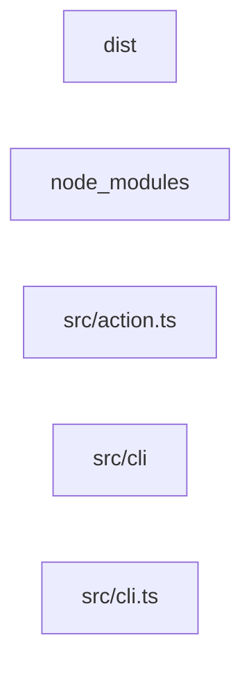

# Architecture

<!-- archmap:start -->

## Module Dependencies

## Modules

| Module | Files | Fan-In | Fan-Out | External Deps |
|--------|-------|--------|---------|---------------|
| `dist` | 9 | 0 | 0 | - |
| `node_modules` | 1579 | 0 | 0 | - |
| `src/action.ts` | 1 | 0 | 0 | - |
| `src/cli` | 1 | 0 | 0 | - |
| `src/cli.ts` | 1 | 0 | 0 | - |
| `src/graph` | 1 | 0 | 0 | - |
| `src/index.ts` | 1 | 0 | 0 | - |
| `src/lock` | 1 | 0 | 0 | - |
| `src/parser` | 4 | 0 | 0 | - |
| `src/render` | 1 | 0 | 0 | - |
| `src/resolver` | 1 | 0 | 0 | - |
| `src/rules` | 1 | 0 | 0 | - |
| `src/types.ts` | 1 | 0 | 0 | - |
| `tsup.config.ts` | 1 | 0 | 0 | - |
| `vitest.config.ts` | 1 | 0 | 0 | - |

<!-- archmap:end -->