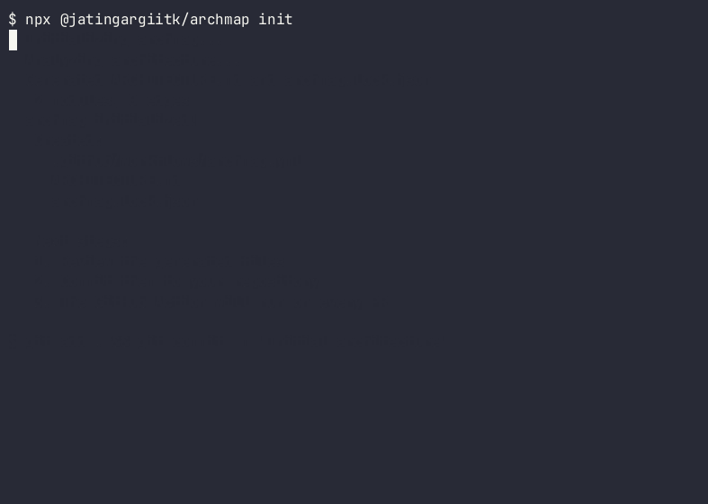
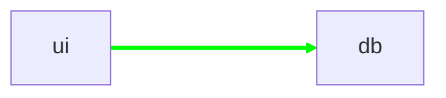

# archmap

> **Snapshot tests for your architecture.** Deterministic module dependency graphs with lockfile diffing.

[](https://www.npmjs.com/package/@jatingargiitk/archmap)
[](https://github.com/jatingargiitk/archmap/actions)
[](./LICENSE)


**Your AI agent just made `ui/` import `db/`. archmap noticed.**

archmap commits a living map of your modules and flags every PR—human or AI—that adds a new dependency between them.

---

## Quick Start

```bash
npx @jatingargiitk/archmap init
```

This creates:
- ✅ `.github/workflows/archmap.yml` - GitHub Action
- ✅ `ARCHITECTURE.md` - Living architecture map ([see ours](./ARCHITECTURE.md))
- ✅ `archmap.lock.json` - Dependency lockfile

Then:

```yaml
# .github/workflows/archmap.yml (auto-generated)
on: [pull_request, push]
permissions: { contents: write, pull-requests: write }
jobs:
  archmap:
    runs-on: ubuntu-latest
    steps:
      - uses: actions/checkout@v4
      - uses: jatingargiitk/archmap@v0
```

---

## What Problem Does This Solve?

**The Problem:** AI agents (and humans) quietly add dependencies that violate your architecture. You discover this months later when the codebase is unmaintainable.

**The Solution:** archmap tracks your module-level dependency graph in a lockfile. New cross-module edges trigger a required approval step, making architecture changes visible and intentional.

Think of it as snapshot testing, but for your architecture.

---

## Example: Before & After

### Before archmap

```diff
// src/ui/UserProfile.tsx
+ import { getUserFromDB } from '../db/users';  // Oops! UI directly importing from DB
```

✅ Tests pass  
✅ Linter passes  
✅ PR approved  
❌ Architecture silently violated

### After archmap

The PR gets a sticky comment:



```diff
## 🗺️ archmap

**+1 new edge, -0 removed**

### Changes



#### Added Dependencies
- `ui` → `db`

---

To accept these changes, run:
\```bash
npx @jatingargiitk/archmap accept
git add ARCHITECTURE.md archmap.lock.json
git commit -m "chore: update architecture map"
\```
```

Now the reviewer knows exactly what changed architecturally, and the decision is explicit.

---

## Features

- ✅ **100% Deterministic** - Same input, same output. No LLM or API key required
- ✅ **Fast** - Parses with `web-tree-sitter` WASM (TS/JS + Python in v0.1)
- ✅ **Lockfile Diffing** - Git-friendly JSON lockfile tracks accepted edges
- ✅ **GitHub Action** - Sticky PR comments show only added/removed edges
- ✅ **Optional Gate Mode** - Fail CI if unapproved edges are added
- ✅ **Deny Rules** - `deny: { from: "ui/**", to: "db/**" }`
- ✅ **Living Docs** - `ARCHITECTURE.md` with Mermaid diagram, auto-regenerated
- ✅ **Agent Skill** - Works with Claude Code, Cursor, and Codex

---

## CLI Commands

```bash
npx @jatingargiitk/archmap init          # Initialize archmap
npx @jatingargiitk/archmap render        # Generate ARCHITECTURE.md and lock
npx @jatingargiitk/archmap diff          # Show diff against main
npx @jatingargiitk/archmap check         # Check for unapproved changes
npx @jatingargiitk/archmap accept        # Accept current changes
```

---

## Configuration

Optional `archmap.yml`:

```yaml
modules:
  roots: [src, packages/*, apps/*]
  depth: 1                         # 0 = collapse entire root, 1+ = subfolders

ignore:
  - "**/*.test.*"
  - "**/fixtures/**"

rules:
  - deny: { from: "ui/**", to: "db/**" }
  - deny: { from: "api/**", to: "ui/**" }

mode: comment  # or "gate" to fail CI on unapproved edges
```

---

## Agent Skill

archmap ships with a skill for Claude Code, Cursor, and Codex:

**Install:**
```bash
npx skills add jatingargiitk/archmap
```

The agent will now run `archmap check` before finishing tasks, catching architectural drift automatically.

---

## Comparison

| | **archmap** | graphify | CodeBoarding | pr-lens | dependency-cruiser |
|---|---|---|---|---|---|
| **Focus** | Architecture guarding | Agent memory | Platform + analysis | PR explainer | Linting |
| **Deterministic** | ✅ Yes | Hybrid | LLM-driven | LLM-driven | ✅ Yes |
| **No API Key** | ✅ Yes | ✅ Yes | ❌ Needs key | ❌ Needs key | ✅ Yes |
| **Lockfile Diffing** | ✅ Yes | ❌ No | ❌ No | ❌ No | ❌ No |
| **Living Docs** | ✅ Committed | Local HTML | Web platform | Per-PR only | Config file |
| **Languages** | TS/JS, Python | 40+ | 9 | General | JS/TS only |
| **Setup** | 1 workflow file | uv + skill | Hosted + telemetry | App or Action | Config wizard |

**Use archmap when:**
- You want snapshot testing for architecture
- You're reviewing AI-written code
- You need a deterministic, zero-config solution

**Use graphify when:**
- You need agent context and memory
- You want queryable knowledge graphs

---

## FAQ

### Does archmap work with monorepos?

Yes! Configure `modules.roots` to match your structure:

```yaml
modules:
  roots: [packages/*, apps/*]
  depth: 0  # Collapse each package into one node
```

### What about fork PRs?

archmap uses read-only tokens for forks. It posts a comment but cannot update files. The reviewer runs `archmap accept` locally.

### Does anything leave my runner?

No. archmap is 100% local. The optional `explain` mode (not yet implemented) will send structural diffs (JSON) to an LLM, but never your code.

### How is this different from Dependabot?

Dependabot tracks external package updates. archmap tracks your internal module architecture.

### Can I use this for Go/Rust/Java?

Not yet. v0.1 supports TypeScript/JavaScript and Python. Go is planned for v0.2.

---

## Development

```bash
git clone https://github.com/jatingargiitk/archmap
cd archmap
npm install
npm test
npm run build
```

---

## Publish Instructions (for maintainers)

```bash
# 1. Ensure tests pass and everything is committed
npm test
npm run build

# 2. Update version in package.json (if not already done)
npm version patch  # or minor, or major

# 3. Login to npm (one time)
npm login

# 4. Publish to npm with provenance
npm publish --access public --provenance

# 5. Create GitHub release
git tag v0.1.0
git push origin v0.1.0
gh release create v0.1.0 --title "v0.1.0" --notes "Initial release"
```

---

## Regenerating the Demo GIF

The demo GIF is recorded with [VHS](https://github.com/charmbracelet/vhs). To regenerate:

```bash
# Install dependencies
# - vhs: https://github.com/charmbracelet/vhs
# - ttyd: https://github.com/tsl0922/ttyd

# Record the demo
vhs docs/demo.tape

# Output: docs/demo.gif (~700KB)
```

The demo shows:
1. A cross-module import violation (`ui → db`)
2. `archmap check` detecting the unapproved edge
3. `archmap diff` showing the new dependency with file:line
4. `archmap accept` approving the change
5. `archmap check` passing after acceptance

---

## License

MIT © Jatin Garg

---

**Made for developers reviewing AI-written code.**  
Track architecture. Make drift visible. Keep understanding your codebase.
