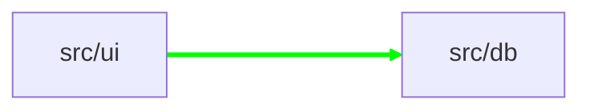

## 🗺️ archmap

**+1 new edge, 0 removed**

### Changes



#### Added Dependencies

- `src/ui` → `src/db` ([src/ui/Button.ts:1](https://github.com/jatingargiitk/archmap/blob/abc123/src/ui/Button.ts#L1))

---

To accept these changes, run:
```bash
npx @jatingargiitk/archmap accept
git add ARCHITECTURE.md archmap.lock.json
git commit -m "chore: update architecture map"
```

<!-- archmap-comment -->
