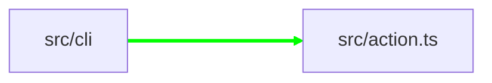

# PR Comment Example

This shows what the archmap GitHub Action posts on pull requests.

## Example from Demo PR #4

## 🗺️ archmap

**+22 new edges, 0 removed**

### ⚠️ Rule Violations

- Module src/cli is not allowed to depend on src/action.ts
  - Rule: `deny: src/cli → src/action*`

### Changes


*(Mermaid diagram truncated for clarity)*

#### Added Dependencies

- `src/action.ts` → `src/graph` ([src/action.ts:7](src/action.ts#L7))
- `src/action.ts` → `src/lock` ([src/action.ts:9](src/action.ts#L9))
- `src/action.ts` → `src/parser` ([src/action.ts:5](src/action.ts#L5))
- `src/action.ts` → `src/render` ([src/action.ts:8](src/action.ts#L8))
- `src/action.ts` → `src/resolver` ([src/action.ts:6](src/action.ts#L6))
- `src/action.ts` → `src/rules` ([src/action.ts:10](src/action.ts#L10))
- `src/action.ts` → `src/types.ts` ([src/action.ts:11](src/action.ts#L11))
- **`src/cli` → `src/action.ts` ([src/cli/index.ts:12](src/cli/index.ts#L12))** ⚠️ Violates deny rule
- `src/cli` → `src/graph` ([src/cli/index.ts:6](src/cli/index.ts#L6))
- *(... additional edges with file:line locations)*

---

To accept these changes, run:
```bash
npx @jatingargiitk/archmap accept
git add ARCHITECTURE.md archmap.lock.json
git commit -m "chore: update architecture map"
```

---

**Key Features Demonstrated:**
- ✅ Rule violation flagged with clear message
- ✅ File:line locations for each import (clickable GitHub links)
- ✅ Mermaid diagram showing architectural changes
- ✅ Instructions for accepting changes
- ✅ Sticky comment (updates on new commits)
- ✅ Gate mode fails the CI check when violations exist
